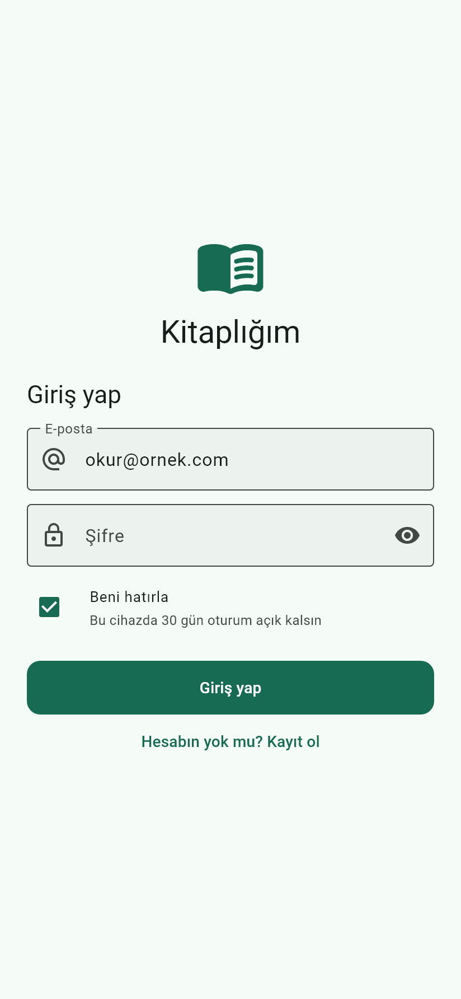
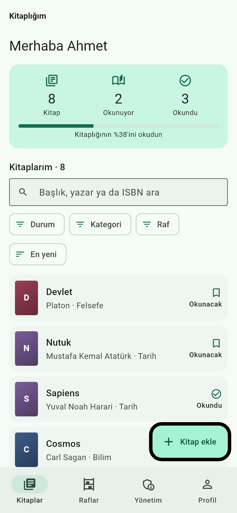
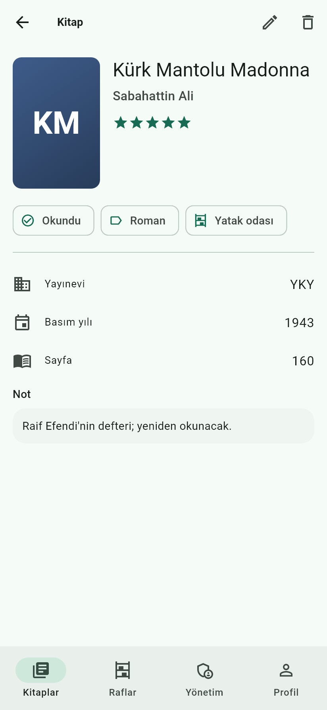
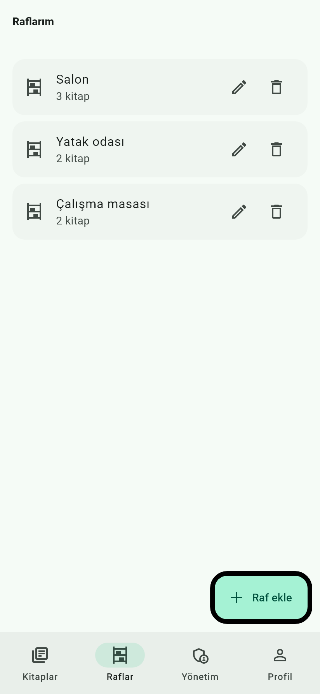
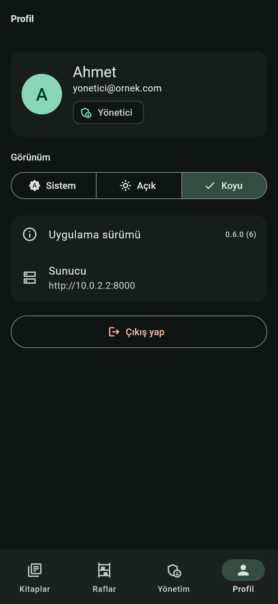
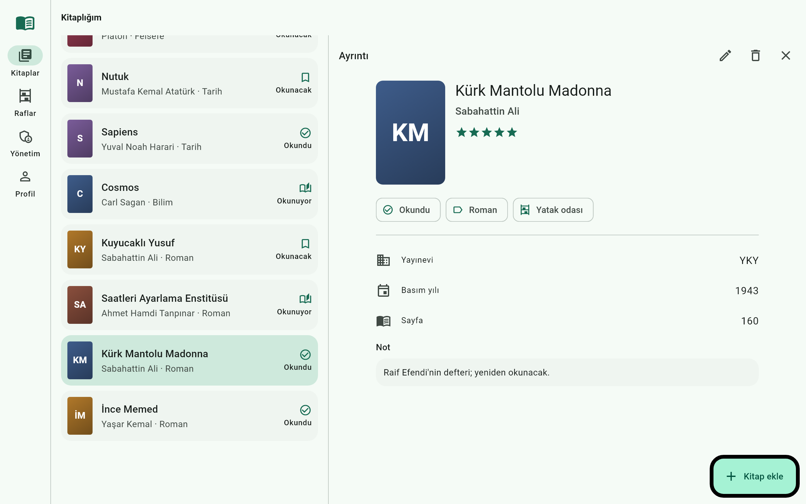
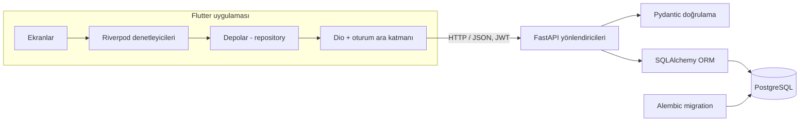

# Kitaplığım

[](https://github.com/ahmettahae/BLM4587/actions/workflows/ci.yml)

BLM4587 iOS ile Mobil Uygulama Geliştirme I (Flutter) dönem projesi. Kişisel kitap koleksiyonunu kataloglayan mobil uygulama. Sürüm **0.6.0**.

- `api/`: FastAPI Web API (Python), PostgreSQL, SQLAlchemy ve Alembic
- `mobile/`: Flutter mobil uygulaması (Android hedefli; telefon ve tablet düzeni)

Grup üyeleri: Ahmet Taha Erol (`ahmettahae`), Semih Berkan Okutan (`semihberkanokutan`).

## Ekran görüntüleri

| Giriş | Kitaplar | Ayrıntı | Raflar | Profil (koyu tema) |
|---|---|---|---|---|
|  |  |  |  |  |

Tablette liste ve ayrıntı yan yana:



(Görüntüler testlerden üretilir: `mobile` klasöründe `EKRAN_GORUNTUSU=1 flutter test --update-goldens test/ekran_goruntuleri_test.dart`.)

## Mimari



- Mobil uygulama veritabanına değil yalnız kendi API'mize bağlanır.
- Ekranlar ağ kodunu görmez: ekran → denetleyici (Riverpod) → depo → Dio.
- Oturum: kısa ömürlü erişim token'ı (30 dk) + yenileme token'ı. Erişim token'ı dolunca ara katman sessizce yeniler ve isteği tekrarlar.
- **Beni hatırla:** işaretliyse yenileme token'ı 30 gün geçerli olur ve cihazın güvenli deposuna (Android Keystore) yazılır. İşaretli değilse 12 saat geçerli olur ve yalnız bellekte tutulur.

## Özellikler

- Kayıt, giriş ("beni hatırla"), otomatik oturum yenileme, onaylı çıkış; iki rol (kullanıcı, yönetici)
- Kitap ekle / düzenle / sil (silmede "Geri al"); ISBN'den kapak (Open Library), yoksa baş harfli kapak. Not: kapak için kitabın ISBN'i openlibrary.org'a gönderilir
- Arama, durum / kategori / raf filtresi, sıralama (en yeni, en eski, başlık, yazar, puan), kaydırdıkça yükleme
- Okuma özeti (toplam, okunuyor, okundu ve okunma oranı)
- Raflar, yöneticiye özel kategori yönetimi
- Alt gezinme çubuğu; tablette yan gezinme ile liste ve ayrıntı yan yana
- Profil: hesap bilgisi, açık / koyu / sistem teması, uygulama sürümü
- Türkçe arayüz (sistem metinleri dahil), kendi ikonu ve açılış ekranı

## Web API kurulumu

Gerekenler: Python 3.12 ve PostgreSQL 18 (bu sürümlerle geliştirildi ve denendi).

1. PostgreSQL'de boş bir veritabanı oluştur:
   ```
   createdb -U postgres -E UTF8 kitapligim
   ```
   (Windows'ta Türkçe yerel ayar `initdb`'yi bozarsa kümeyi `--locale=C` ile oluştur.)
2. Sanal ortamı kur ve paketleri yükle:
   ```
   cd api
   py -3 -m venv .venv
   .venv\Scripts\activate
   pip install -r requirements.txt
   ```
3. `.env.example` dosyasını `.env` olarak kopyala; `DATABASE_URL` içindeki şifreyi kendi PostgreSQL şifrenle, `JWT_SECRET` değerini de rastgele uzun bir değerle değiştir (üretmek için dosyadaki komutu çalıştır). `.env` depoya girmez.
4. Tabloları oluştur (migration):
   ```
   alembic upgrade head
   ```
5. API'yi başlat (`--host 0.0.0.0` emülatörün ve telefonun bilgisayara ulaşabilmesi için):
   ```
   uvicorn app.main:app --reload --host 0.0.0.0
   ```
   Swagger belgesi: http://127.0.0.1:8000/docs, sağlık kontrolü: http://127.0.0.1:8000/health
6. İlk yöneticiyi oluştur: önce uygulamadan ya da Swagger'dan `POST /auth/register` ile kayıt ol, sonra:
   ```
   python -m app.cli yonetici-yap kisi@ornek.com
   ```
   (Kayıt olan herkes `user` rolü alır; yönetici yalnızca bu komutla atanır.)

### Kimlik uçları
- `POST /auth/register`
- `POST /auth/login`: form alanları `username` (e-posta), `password` ve isteğe bağlı `remember_me`. Erişim token'ı (30 dk), `expires_in` ve `refresh_token` döner.
- `POST /auth/refresh`: `{"refresh_token": ...}` gönderilir, yeni bir token çifti döner. Eski yenileme token'ı iptal olur. Cevap telefona ulaşmadıysa aynı token 30 saniye içinde bir kez daha kullanılabilir (yeni çift verilir). Daha sonra tekrar kullanılırsa token çalınmış sayılır ve kullanıcının tüm yenileme token'ları iptal edilir. Çıkışla iptal edilen token yalnız `401` alır. Süresi dolmuş ve bir günden eski çıkış token'ları giriş ve yenilemede silinir; döndürülmüş token'lar çalınma tespiti için ömürleri boyunca saklanır.
- `POST /auth/logout`: yenileme token'ını iptal eder.
- `GET /me` ve `GET /admin/ping` (yalnız yönetici).

Swagger'da "Authorize" düğmesiyle giriş yapılabilir. Aynı e-postaya aynı IP'den 15 dakika içinde 5, bir IP'den toplam 20 yanlış şifre denenirse giriş 15 dakika kilitlenir (`429`, `Retry-After` başlığı). Kilit IP'ye bağlıdır; başka ağdan giren hesap sahibi etkilenmez. Sayaçlar bellektedir (tek süreç). API bir ters proxy arkasına konursa uvicorn'u `--proxy-headers --forwarded-allow-ips=<proxy IP>` ile çalıştırın; aksi hâlde herkes aynı IP görünür. Bilinen sınırlar: IPv6'da her adres ayrı sayılır, aynı anda gönderilen istekler sınırı kısa süre aşabilir.

### Hata biçimi
Her hata aynı biçimde döner:
```json
{"detail": "Girdiğin bilgileri kontrol et", "kod": 422, "hatalar": [{"alan": "author", "mesaj": "En fazla 255 karakter olabilir"}]}
```
Doğrulama mesajları Türkçedir. Beklenmeyen hatalar iç ayrıntı sızdırmadan `500` döner. Her istek `api/logs/api.log` dosyasına yöntem, yol, durum ve süreyle yazılır; token, sorgu metni ve gövde loglanmaz.

### Kitap uçları (giriş gerekir)
`GET /books` (kendi kitapların, en yeni başta), `POST /books`, `GET /books/{id}`, `PUT /books/{id}` (tüm alanları yeniden yazar), `DELETE /books/{id}`. Her kullanıcı yalnız kendi kitaplarını görür; başkasının kitabı `404` döner.

Alanlar: `title` ve `author` zorunlu; `isbn` (10 ya da 13 hane, tire ve boşluklar atılır), `publisher`, `year` (gelecek yıldan büyük olamaz), `pages` (1-50000), `note` (en fazla 2000 karakter), `status` (`okunacak`, `okunuyor`, `okundu`), `rating` (1-5), `category_id`, `shelf_id` (kendi rafın olmalı).

### Kategori uçları (giriş gerekir)
`GET /categories` (herkes okur; Türkçe alfabe sırasıyla, her kategoride `book_count`), `POST /categories`, `PUT /categories/{id}`, `DELETE /categories/{id}` (yazma işlemleri yalnız **yönetici**, değilse 403). Ad zorunlu (en fazla 100 karakter) ve büyük/küçük harfe bakmadan benzersiz (aynı ad 409). Kategori silinince o kategorideki kitaplar silinmez, kategorisiz kalır. Kitap eklerken `category_id` olarak verilir.

### Raf uçları (giriş gerekir)
`GET /shelves` (kendi rafların; Türkçe alfabe sırasıyla, her rafta `book_count`), `POST /shelves`, `PUT /shelves/{id}` (yeniden adlandırır), `DELETE /shelves/{id}`. Her kullanıcı yalnız kendi raflarını görür; başkasının rafı `404` döner. Ad zorunlu (en fazla 100 karakter) ve kullanıcının rafları içinde büyük/küçük harfe bakmadan benzersiz (aynı ad 409; iki kullanıcı aynı adı kullanabilir). Raf silinince raftaki kitaplar silinmez, rafsız kalır. Kitap eklerken `shelf_id` olarak verilir.

### Arama ve filtre
`GET /books` şu sorgu parametrelerini alır, verilenlerin hepsine uyan kitaplar döner:
- `search`: başlık, yazar ya da ISBN içinde arar; Türkçe büyük/küçük harf duyarsız (`istanbul` → "İSTANBUL"). Yalnız boşluksa yok sayılır.
- `category`, `shelf`: kategori / raf numarası. Başkasının raf numarası boş liste döner.
- `status`: `okunacak`, `okunuyor`, `okundu` (başka değer 422).
- `sort`: `yeni` (varsayılan), `eski`, `baslik`, `yazar`, `puan` (başlık ve yazar Türkçe alfabe sırasıyla; puansızlar sonda).
- `limit` (1-200, varsayılan 50) ve `offset`: sayfalama. Filtreye uyan toplam sayı `X-Total-Count` başlığında döner.

`GET /books/summary`: okuma durumlarına göre kitap sayıları (`toplam`, `okunacak`, `okunuyor`, `okundu`).

Örnek (Swagger `http://localhost:8000/docs` → `GET /books` → "Try it out"): `/books?search=atay&status=okundu&sort=baslik&limit=10`.

Testler (PostgreSQL açık ve `.env` dolu olmalı): `pytest`. Her push'ta GitHub Actions API ve mobil testlerini de çalıştırır (`.github/workflows/ci.yml`).

### Yeni migration oluşturma
Modeller (`api/app/models.py`) değişince: `alembic revision --autogenerate -m "açıklama"` ardından `alembic upgrade head`.

## Veritabanı tabloları
`users`, `categories` (yönetici yönetir), `shelves`, `books`, `loans`, `refresh_tokens` (oturum yenileme; token'ın kendisi değil SHA-256 özeti saklanır). Bire-çok ilişkiler: kullanıcı→kitap, kullanıcı→raf, kullanıcı→yenileme token'ı, kategori→kitap, raf→kitap, kitap→ödünç.

## Mobil uygulama kurulumu
Gerekenler: Flutter 3.47 (Dart 3.x ile bu sürümle geliştirildi), Android SDK ve bir emülatör ya da USB hata ayıklaması açık Android telefon. Projeyi Türkçe karakter içermeyen bir klasörde tut (ör. `C:\dev\projeler\kitapligim`).

```
cd mobile
flutter pub get
flutter run
```

**API adresi:** Varsayılan `http://10.0.2.2:8000` (Android emülatöründe bilgisayarın localhost'u). Gerçek telefonda bilgisayarın yerel ağ adresini ver; telefon ve bilgisayar aynı Wi-Fi'de olmalı ve güvenlik duvarı 8000 numaralı bağlantı noktasına izin vermeli:
```
flutter run --dart-define=API_URL=http://192.168.1.20:8000
```
Testler: `flutter test`, kod denetimi: `flutter analyze`.

Yönetici hesabıyla giriş yapınca gezinme çubuğunda **Yönetim** sekmesi çıkar. Kategori ekleme, düzenleme ve silme ekranı buradan açılır. Bir kullanıcıyı yönetici yapmak için API klasöründe `python -m app.cli yonetici-yap <e-posta>` çalıştırılır.

**APK (release):**
```
flutter build apk --release --dart-define=API_URL=http://192.168.137.1:8000
```
`192.168.137.1`, Windows "Mobil etkin nokta" açıkken bilgisayarın sabit adresidir; tablet bu Wi-Fi'a bağlanır.
- `mobile/android/key.properties` ve `.jks` dosyası varsa APK kendi anahtarımızla imzalanır. Bu dosyalar depoya girmez.
- Dosyalar yoksa debug anahtarıyla imzalanır; böylece herkes derleyebilir.

**Sürüm:** `mobile/pubspec.yaml` içindeki `version` (şu an `0.6.0+6`) ve API'nin `app/main.py` sürümü her haftanın teslimiyle birlikte artırılır. Uygulamadaki sürüm Profil ekranında görünür.

> Geliştirme sürümü şifresiz `http` kullanır (`usesCleartextTraffic`). Yayın sürümünde https'e geçilip bu ayar kaldırılmalı.
